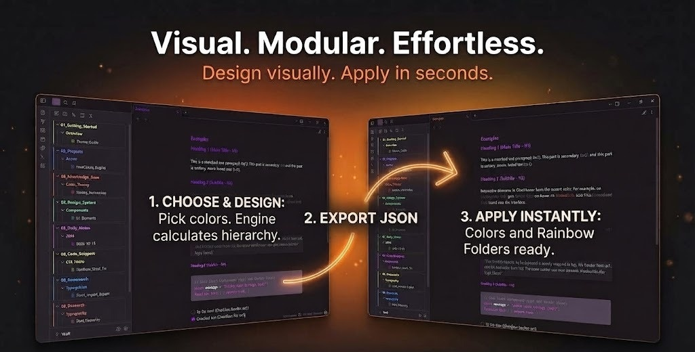
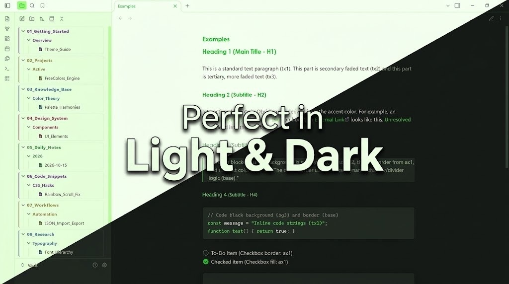
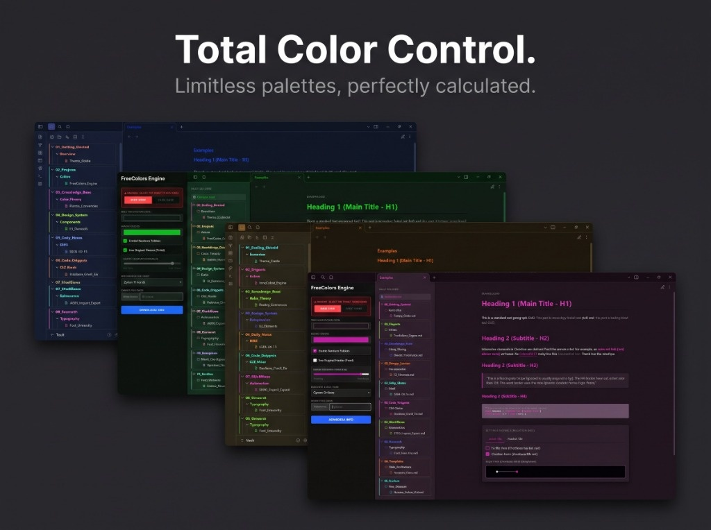
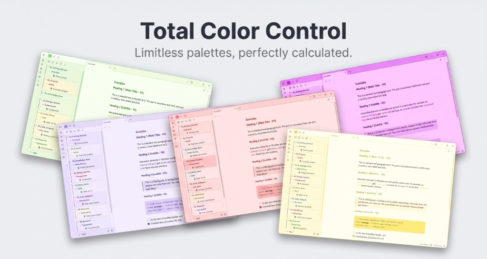

# FreeColors for Obsidian

FreeColors is an Obsidian theme built around an external color simulation engine. Instead of manually editing CSS files or tweaking dozens of individual color pickers in application settings, you design your palette visually in an interactive HTML tool, export a single JSON configuration, and apply it through the Style Settings plugin.

## Prerequisites

FreeColors relies on the [Style Settings](https://github.com/mgmeyers/obsidian-style-settings) community plugin to store and inject color profiles. Install and enable Style Settings before applying custom configurations.

---

## How It Works

FreeColors separates palette design from theme rendering:

1. **Design**: Select a base background and primary accent in the FreeColors Simulator. The engine calculates contrast ratios, secondary surfaces, border shades, and text steps automatically.
2. **Export**: The simulator outputs a formatted `.json` file containing all computed hex definitions.
3. **Import**: Load the file into Style Settings.
4. **Render**: The theme maps these imported values to Obsidian's CSS custom properties in real time.

---

## Setup Guide

### 1. Install the Theme
1. Open Obsidian **Settings > Appearance**.
2. Under **Themes**, click **Manage**.
3. Search for **FreeColors** and select **Install and Use**.

### 2. Open the Simulator
Use the simulator through either method:
* **Web**: Access the <a href="https://erulmu.github.io/freecolors/" target="_blank" rel="noopener noreferrer">FreeColors Web Simulator</a> directly in your browser.
* **Local**: Open `index.html` from this repository in any modern browser without an internet connection.

### 3. Generate a Palette
1. Choose your target interface mode (Dark or Light). Exported profiles apply specifically to the selected mode.
2. Set your **Base Background** (`bg1`) and **Accent Color** (`ax1`).
3. Configure the **Rainbow Folders** section if you want colored folder hierarchies.
4. Click **Download JSON** to save your palette file.

### 4. Import into Obsidian
1. Open Obsidian **Settings > Style Settings**.
2. Click **Import** in the upper right corner.
3. Select your exported `.json` file and save.

### 5. Enable Rainbow Folders (Optional)
To turn on colored folder tiers:
1. Open **Settings > Style Settings > FreeColors**.
2. Toggle **Enable Rainbow Folders** to **ON**.
3. Folder tabs will inherit the calculated rainbow sequence from your imported profile.

---

## Light and Dark Modes

Each mode operates on independent color calculations to maintain readable contrast ratios across diverse displays.

### Palette Diversity

The calculation engine supports any background hue, from deep slate and charcoal to warm earth tones, soft pastels, and stark monochromatic setups.

---

## Helper Snippets

For advanced setups or standalone usage, helper files are included in the `snippets/` directory:

* **`snippets/freecolors-rainbow-fixer.js`**: An optional script for vaults with deep folder trees. Obsidian re-uses DOM nodes during virtual scrolling, which can cause CSS `:nth-child` indices to cycle as you scroll. This script binds permanent index attributes (`data-fc-index="1..10"`) to root folders based on their alphabetical order. Compatible with User Plugins or QuickAdd macros.
* **`snippets/freecolors-rainbow.css`**: Standalone CSS snippet containing the rainbow folder styles, allowing you to use the folder color system independently of the full theme.

---

## Troubleshooting

### Colors revert to default after restart
Verify that the FreeColors theme is currently active and that your JSON profile was imported and saved within Style Settings. If multiple vaults share configurations, the profile must be imported per vault.

### Error: "St(...) is not iterable" during import
This error occurs when the imported JSON contains malformed or unexpected data structures. Only import files generated directly by the FreeColors Simulator. Avoid manual edits to the JSON unless following the exact variable schema.

---

## License

This project is licensed under the MIT License.